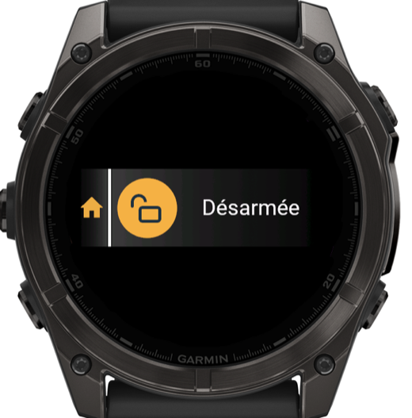
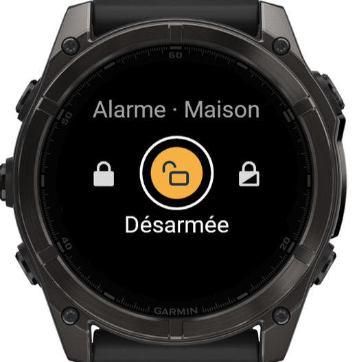
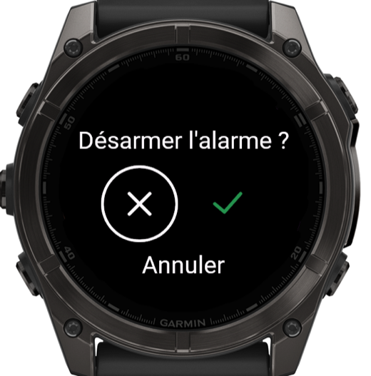

# Alarme Somfy Protect depuis une montre Garmin

Armer, armer partiellement ou désarmer une alarme **Somfy Protect** depuis une montre
Garmin (fēnix 8, Venu 4, epix 2), avec un aperçu de l'état dans la liste des glances.

| Aperçu (glance) | Écran d'action | Confirmation |
|:---:|:---:|:---:|
|  |  |  |
| État actuel en un coup d'œil | Choix de l'état : fermé, ouvert, partiel | Désarmement confirmé par ✕ / ✓ |

*Captures du simulateur Connect IQ, fēnix 8 47 mm.*

Le projet contient trois briques indépendantes :

| Dossier | Rôle |
|---|---|
| [`somfy_alarme.py`](somfy_alarme.py) | Script en ligne de commande (Mac/Linux) pour piloter l'alarme. Sert aussi de référence pour l'API Somfy. |
| [`worker/`](worker/) | Passerelle **Cloudflare Worker** : détient les identifiants Somfy et expose une petite API protégée par clé. |
| [`garmin/`](garmin/) | App **Connect IQ** (Monkey C) pour la montre. |

> ⚠️ Somfy ne publie pas d'API officielle pour Somfy Protect. Ce projet utilise l'API de
> l'application mobile (`api.myfox.io`), comme l'intégration Home Assistant. Somfy peut la
> modifier sans préavis.

---

## Sommaire

1. [Fonctionnement](#fonctionnement)
2. [Secrets et sécurité](#secrets-et-sécurité)
3. [Script Python](#1-script-python-facultatif)
4. [Configurer le Worker Cloudflare](#2-configurer-le-worker-cloudflare)
5. [Configurer et installer l'app montre](#3-configurer-et-installer-lapp-montre)
6. [Dépannage](#dépannage)
7. [Détails techniques](#détails-techniques)

---

## Fonctionnement

### Architecture

```
 Montre Garmin ──Bluetooth──▶ Garmin Connect ──HTTPS──▶ Cloudflare Worker ──HTTPS──▶ API Somfy Protect
 (app Connect IQ)              (téléphone)              (clé API + secrets)          (api.myfox.io)
```

- La montre n'accède pas directement à Internet : ses requêtes passent par l'app
  **Garmin Connect** du téléphone, qui doit être à portée Bluetooth.
- Le **Worker** garde l'e-mail et le mot de passe Somfy (secrets chiffrés Cloudflare),
  gère la connexion OAuth et le renouvellement du jeton. La montre ne connaît qu'une
  clé API propre au Worker.
- Si Somfy change son API, seul le Worker est à mettre à jour.

### App montre

**Aperçu (glance)** : le cadenas de l'état actuel sur un rond jaune, et le nom de l'état centré à
côté (*Armée*, *Partielle*, *Désarmée*). C'est le dernier état connu, mis à jour à chaque
ouverture de l'app.

**Écran d'action** : titre `Alarme · <nom du site>`, puis trois cadenas façon Somfy :

| Fermé | Ouvert | Partiel |
|---|---|---|
| Armée (totale) | Désarmée | Armée partiellement |

- L'**état actuel** est sur un rond jaune.
- L'**état sélectionné** est entouré d'un anneau blanc, avec son nom en dessous.
- À l'ouverture, l'état est actualisé automatiquement.
- Après une action : *Envoi…* puis *Confirmé* (avec vibration), ou un message d'erreur.

**Confirmation du désarmement** : écran en français, même principe visuel : symboles
**✕** (annuler, sélectionné par défaut) et **✓** en vert (désarmer).

**Commandes**

| Geste | Écran d'action | Confirmation |
|---|---|---|
| UP / DOWN *(fēnix, epix)* | déplacer la sélection | changer de choix |
| Balayage haut / bas *(toutes)* | déplacer la sélection | changer de choix |
| START | appliquer la sélection | valider le choix |
| **Toucher une icône** | appliquer **cette** icône | valider **ce** symbole |
| Toucher le titre | actualiser l'état | — |
| UP maintenu (menu) | actualiser l'état | — |
| BACK / balayage droite | quitter | annuler |

Le toucher agit toujours sur l'élément touché, indépendamment de la sélection.

### Montres compatibles

| Modèle | Identifiant Connect IQ |
|---|---|
| fēnix 8 AMOLED 43 mm | `fenix843mm` |
| fēnix 8 AMOLED 47 mm | `fenix847mm` |
| fēnix 8 Pro 47 mm | `fenix8pro47mm` |
| fēnix 8 Solar 47 mm | `fenix8solar47mm` |
| fēnix 8 Solar 51 mm | `fenix8solar51mm` |
| Venu 4 41 mm | `venu441mm` |
| Venu 4 45 mm | `venu445mm` |
| epix (Gen 2) | `epix2` |
| epix Pro (Gen 2) 42 / 47 / 51 mm | `epix2pro42mm` / `epix2pro47mm` / `epix2pro51mm` |

D'autres modèles peuvent être ajoutés dans [`garmin/manifest.xml`](garmin/manifest.xml)
(API Connect IQ 4.0 minimum, écran rond).

---

## Secrets et sécurité

Aucun secret ni binaire compilé n'est versionné (voir [`.gitignore`](.gitignore)).

| Secret | Où il vit | Versionné ? |
|---|---|---|
| E-mail / mot de passe Somfy | Secrets du Worker Cloudflare (`SOMFY_USER`, `SOMFY_PASSWORD`) | Non |
| Clé API du Worker | Secret du Worker (`API_KEY`) **et** `garmin/resources/settings/properties.xml` | Non |
| Adresse du Worker | `garmin/resources/settings/properties.xml` | Non |
| Clé de signature Connect IQ | `garmin/developer_key.der` | Non |
| Jeton Somfy du script Python | `~/.config/somfy-alarme/token.json` (droits 600) | Non |
| Binaires de l'app | `garmin/bin/*.prg` | Non |

Points notables :

- Le Worker compare la clé API en temps constant et ne contacte jamais Somfy sans
  clé valide.
- Le script Python ne stocke jamais le mot de passe : seul le jeton OAuth renouvelable
  est conservé.
- Les identifiants OAuth *client* présents dans le code (`CLIENT_ID` / `CLIENT_SECRET`)
  sont ceux, publics, de l'application mobile Somfy ; ils figurent dans la bibliothèque
  open source [`somfy-protect-api`](https://pypi.org/project/somfy-protect-api/). Ce ne
  sont pas des secrets personnels.
- **Garde une copie de `developer_key.der`** hors du dépôt : sans elle, il faut désinstaller
  l'app de la montre avant de pouvoir installer une nouvelle version.

---

## 1. Script Python (facultatif)

Python 3.9+, bibliothèque standard uniquement.

```bash
python3 somfy_alarme.py statut     # état actuel
python3 somfy_alarme.py on         # armement total
python3 somfy_alarme.py partiel    # armement partiel
python3 somfy_alarme.py off        # désarmement
python3 somfy_alarme.py sites      # liste les sites du compte
python3 somfy_alarme.py logout     # supprime le jeton enregistré
```

- Identifiants demandés au premier lancement (ou variables `SOMFY_USER` / `SOMFY_PASSWORD`).
- Plusieurs sites : définir `SOMFY_SITE_ID` (voir `sites`).
- Après une action, le script vérifie pendant ~10 s que l'état a bien changé.

---

## 2. Configurer le Worker Cloudflare

Tout se fait dans le navigateur, sans rien installer. Guide détaillé :
[`worker/DEPLOIEMENT.md`](worker/DEPLOIEMENT.md).

### a. Générer la clé API

```bash
openssl rand -hex 24
```

Conserve la valeur : elle servira dans le Worker et dans l'app montre.

### b. Créer le Worker

1. Compte gratuit sur <https://dash.cloudflare.com>.
2. **Workers & Pages** → **Create** → **Create Worker** → nom `somfy-alarme` → **Deploy**.
3. **Edit code** → coller le contenu de [`worker/worker.js`](worker/worker.js) → **Deploy**.

### c. Définir les secrets

Worker → **Settings** → **Variables and Secrets** → **Add** (type **Secret**) :

| Nom | Valeur |
|---|---|
| `SOMFY_USER` | e-mail Somfy Protect |
| `SOMFY_PASSWORD` | mot de passe Somfy Protect |
| `API_KEY` | clé générée à l'étape a |
| `SOMFY_SITE_ID` | *(facultatif)* si le compte a plusieurs sites |

### d. (Recommandé) Stockage du jeton

Sans cette étape, le Worker se reconnecte avec le mot de passe à chaque redémarrage.

1. **Storage & Databases** → **KV** → **Create** → `somfy-tokens`.
2. Worker → **Settings** → **Bindings** → **Add** → **KV namespace** : variable `TOKENS`,
   espace `somfy-tokens`.

### e. Tester

```bash
curl -H "Authorization: Bearer TA_CLE" https://somfy-alarme.TON-SOUS-DOMAINE.workers.dev/status
```

Réponse attendue : `{"site":"Maison","status":"disarmed","confirmed":true}`

### API du Worker

Toutes les routes exigent l'en-tête `Authorization: Bearer <API_KEY>`.

| Route | Méthode | Effet |
|---|---|---|
| `/status` | GET | état actuel |
| `/arm` | POST | armement total |
| `/partial` | POST | armement partiel |
| `/disarm` | POST | désarmement |

Réponse : `{"site": "...", "status": "armed|partial|disarmed", "confirmed": true|false}`,
ou `{"error": "..."}` avec un code HTTP 401 / 404 / 500 / 502. Pour une action, le Worker
vérifie pendant ~10 s que Somfy a appliqué le changement (`confirmed`).

---

## 3. Configurer et installer l'app montre

Guide détaillé : [`garmin/INSTALLATION.md`](garmin/INSTALLATION.md).

### a. Prérequis (une fois)

1. **Java** : JDK 17 ou plus récent (ex. Temurin, <https://adoptium.net>).
2. **SDK Connect IQ** : *SDK Manager* depuis <https://developer.garmin.com/connect-iq/sdk/>,
   connexion avec un compte Garmin, puis :
   - onglet **SDKs** : télécharger la dernière version → **Use as current SDK** ;
   - onglet **Devices** : télécharger les modèles voulus (fēnix 8, Venu 4, epix 2).

### b. Renseigner l'adresse et la clé

```bash
cd garmin
cp properties.example.xml resources/settings/properties.xml
```

Puis éditer `resources/settings/properties.xml` :

```xml
<property id="serverUrl" type="string">https://somfy-alarme.TON-SOUS-DOMAINE.workers.dev</property>
<property id="apiKey" type="string">TA_CLE</property>
```

Ce fichier est ignoré par git. (Les réglages ne sont pas modifiables depuis l'app
Garmin Connect pour une app installée hors du Connect IQ Store : ils sont intégrés à la
compilation.)

### c. Compiler

```bash
./build.sh fenix847mm          # produit bin/SomfyAlarme.prg pour ce modèle
./build.sh sim fenix847mm      # compile et lance le simulateur
```

Au premier lancement, `build.sh` génère `developer_key.der` s'il n'existe pas
(et crée `properties.xml` depuis le modèle s'il manque).

### d. Installer sur la montre

1. Installer **OpenMTP** (<https://openmtp.ganeshrvel.com>) : sur macOS, la montre
   n'apparaît pas dans le Finder.
2. Quitter **Garmin Express** s'il est ouvert, brancher la montre en USB, ouvrir OpenMTP.
3. Copier `bin/SomfyAlarme.prg` dans `GARMIN/APPS` sur la montre.
4. Débrancher. L'aperçu « Alarme Somfy » apparaît dans les glances (sinon :
   *Réglages › Apparence › Aperçus › Ajouter*).

Pour mettre à jour : recompiler puis remplacer le fichier dans `GARMIN/APPS`.

---

## Dépannage

| Message sur la montre | Cause probable |
|---|---|
| *Adresse non réglée* / *Clé non réglée* | `properties.xml` contient encore les valeurs d'exemple |
| *Téléphone non connecté* | téléphone hors de portée ou Garmin Connect fermé |
| *Clé refusée* | `apiKey` différente du secret `API_KEY` du Worker |
| *Délai dépassé* | réseau lent ; réessayer |
| *connexion Somfy refusée (identifiants ?)* | secrets `SOMFY_USER` / `SOMFY_PASSWORD` erronés |
| *plusieurs sites : définir SOMFY_SITE_ID* | ajouter le secret `SOMFY_SITE_ID` au Worker |
| *Pas encore confirmé* | Somfy n'a pas encore appliqué la demande ; actualiser |

Les journaux du Worker sont visibles dans Cloudflare, onglet **Logs**.

---

## Détails techniques

### API Somfy Protect utilisée

| Étape | Requête |
|---|---|
| Connexion | `POST https://sso.myfox.io/oauth/oauth/v2/token` (`grant_type=password`, puis `refresh_token`) |
| Sites | `GET https://api.myfox.io/v3/site` → `items[].site_id`, `label`, `security_level` |
| Changer l'état | `PUT https://api.myfox.io/v3/site/{site_id}/security` avec `{"status": "armed" \| "partial" \| "disarmed"}` |

Le changement d'état est asynchrone : le script et le Worker relisent le site jusqu'à
confirmation.

### Structure de l'app Connect IQ

| Fichier | Rôle |
|---|---|
| `source/SomfyApp.mc` | point d'entrée, vue complète et aperçu |
| `source/SomfyGlanceView.mc` | aperçu (rond jaune + état) |
| `source/MainView.mc` | écran d'action, appels réseau, mémorisation de l'état |
| `source/ConfirmView.mc` | écran de confirmation ✕ / ✓ et ses entrées |
| `source/Delegates.mc` | entrées de l'écran d'action |
| `source/LockIcon.mc` | cadenas dessinés en vectoriel (nets sur tous les écrans) |
| `source/SomfyApi.mc` | requêtes vers le Worker, messages d'erreur |
| `source/Labels.mc` | libellés des états |

Les entrées utilisent `InputDelegate` plutôt que `BehaviorDelegate` : ce dernier convertit
un toucher en « START », ce qui appliquerait l'élément sélectionné au lieu de l'élément
touché.

### Arborescence

```
.
├── README.md
├── docs/                        # captures d'écran
├── somfy_alarme.py              # script en ligne de commande
├── worker/
│   ├── worker.js                # Cloudflare Worker (fichier unique)
│   └── DEPLOIEMENT.md
└── garmin/
    ├── manifest.xml             # modèles cibles, permissions
    ├── monkey.jungle
    ├── build.sh                 # compilation / simulateur
    ├── properties.example.xml   # modèle des réglages (à copier)
    ├── INSTALLATION.md
    ├── resources/               # icône, chaînes, réglages
    └── source/                  # code Monkey C
```
